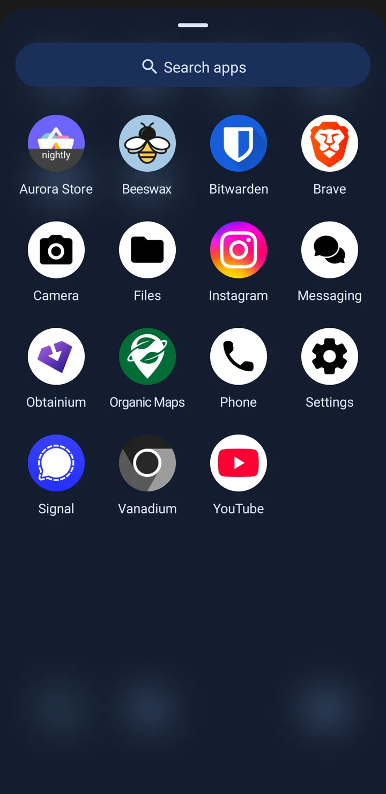
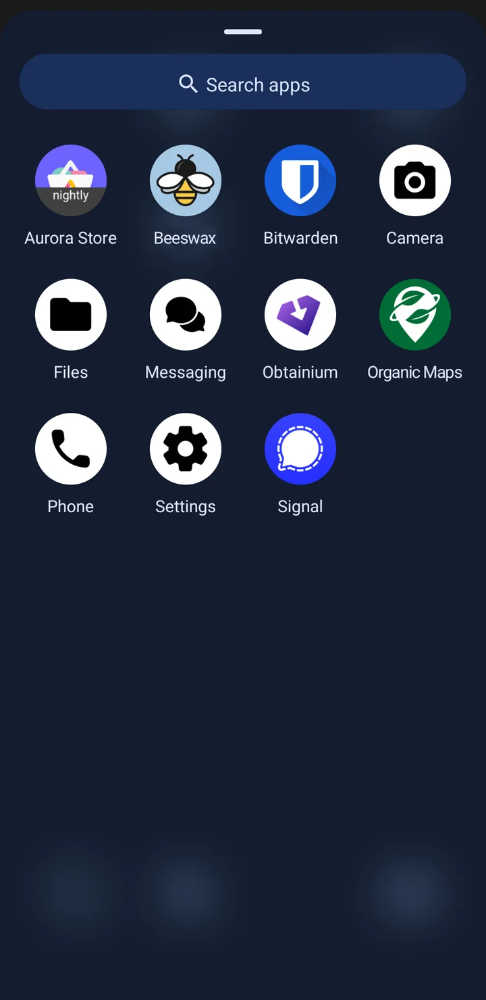

<div align="center"></div>

<h1 align="center">Beeswax</h1>

<h3 align="center">Create a dumbphone on Android</h3>

<p align="center">Beeswax blocks web browsers, newly installed apps and any app you pick until you enter your lock code.<br />Give the code to someone you trust, or put it somewhere inconvenient.</p>

<p align="center">
  <a href="PRIVACY.md#features"></a>
  <a href="app/src/main/AndroidManifest.xml"></a>
  <a href="PRIVACY.md#reproducible-builds"></a>
</p>

<div align="center">
<table>
  <tr>
    <td></td>
    <td></td>
  </tr>
  <tr>
    <td align="center">Before</td>
    <td align="center">After</td>
  </tr>
</table>
</div>

<p align="center"><a href="SETUP.md#screenshots">More screenshots</a></p>

> [!WARNING]
> **Beeswax is in beta.** It has only been tested on GrapheneOS and stock Pixel OS. Before you lock it, read the [setup guide](SETUP.md) and keep your lock code somewhere safe. If the code is lost, the only way back is a factory reset. If something doesn't work as expected, please open an [issue](https://github.com/flourish-today/beeswax/issues).


## Why Beeswax?

- **Block the browser.** Android doesn't provide a built-in way to prevent access to the system browser. Beeswax blocks it, preventing access no matter what version of Android you use. Browsers start out blocked, and you choose whether to keep any.
- **Block any app you pick.** Before you lock, Beeswax lists your apps and you choose which ones to block. Later, you can enter your lock code to block or allow apps.
- **New apps are blocked.** Once Beeswax is locked, every app you install is blocked until you allow it with your lock code. Your apps keep updating as usual.
- **Hard to bypass.** Beeswax's restrictions are locked using a random 16 character code that's generated when you lock it. You don't need to worry about restarts, safe mode, or ADB giving you access. Without your lock code, the only way to use a blocked app or a new app is through a factory reset.
- **Full app updates** Unlike user profile based solutions, Beeswax allows you to update your apps without allowing the ability to install new ones.
- **Privacy and security focused.** Beeswax has one permission, no network access, and no telemetry. It has reproducible builds so you can verify the source code corresponds to the distributed APK.

## What you need

You need an Android phone, a USB-C cable, and a computer with [ADB installed](https://developer.android.com/tools/adb). Android only allows adding a device owner on a phone with no accounts, no other users, and no Private Space, so you'll need to remove these if you have any of them. Alternatively a factory reset will always work. **Back up all important data off your device before you start.**


<h2 align="center">Download</h2>

<div align="center">
  <a href="https://apps.obtainium.imranr.dev/redirect?r=obtainium://add/https://github.com/flourish-today/beeswax/releases"></a>
  <a href="https://github.com/flourish-today/beeswax/releases"></a>
</div>

<p align="center">Verify your download with <a href="https://github.com/soupslurpr/AppVerifier">AppVerifier</a>:</p>

```
org.getflourish.beeswax
F5:37:A3:91:23:40:95:AC:42:53:85:D4:9E:B0:AA:43:C8:ED:84:4D:FC:84:15:F2:1C:C4:BF:63:52:86:34:54
```

## Setup

1. Install Beeswax and make it device owner with a single ADB command.
2. Pick the apps you want to block.
3. Lock Beeswax and keep the lock code somewhere you can't easily reach.
4. Use the code whenever you want to change which apps are blocked.

See the [setup guide](SETUP.md) for the full steps.

## Learn more

-   [How it works](SETUP.md#how-it-works)
-   [FAQ](FAQ.md)
-   [Privacy and security](PRIVACY.md)
-   [GrapheneOS forum thread (shared with Odysseus)](https://discuss.grapheneos.org/d/42598-odysseus-make-your-grapheneos-a-dumbphone)
-   [Issues](https://github.com/flourish-today/beeswax/issues)

## Support

**Monero**

```
82omZG3aUU7gqJhR6dZGSReYvKD7kHFuxj5MGKMAGiJdcSYLnMb9Nky9UBxeuadSSzCNYpwfUueQBdQPEaTXmLH4Tkmbv39
```
## Contact

-   Email: flourish.today@protonmail.com
-   SimpleX: https://smp17.simplex.im/a#OYNzLgLMY-vsrI69LroxLrhc4xkyLGpT2Q5ygNvoaAc

## Public domain

Beeswax is dedicated to the public domain under CC0 1.0. See [LICENSE](LICENSE).
