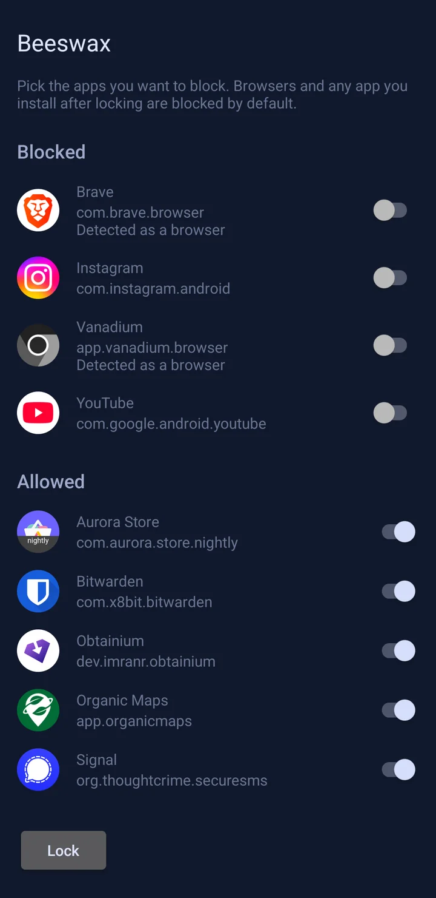
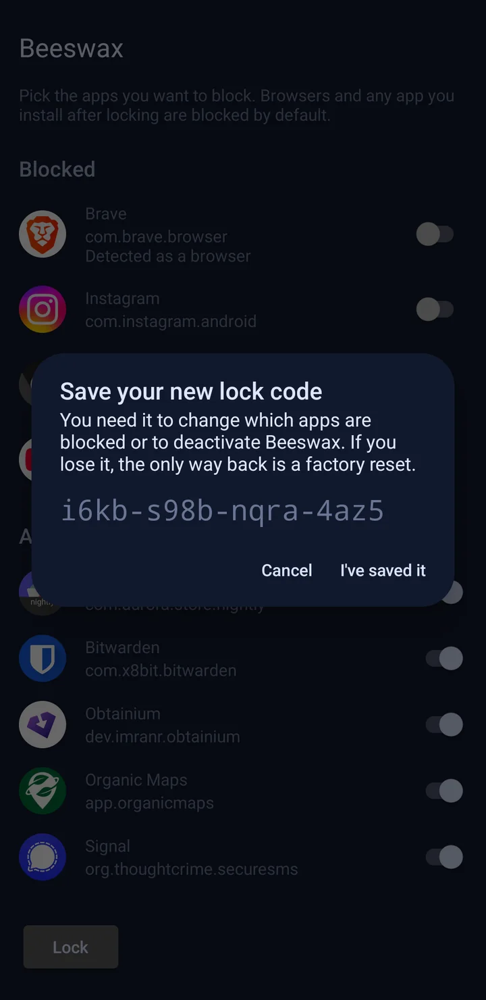
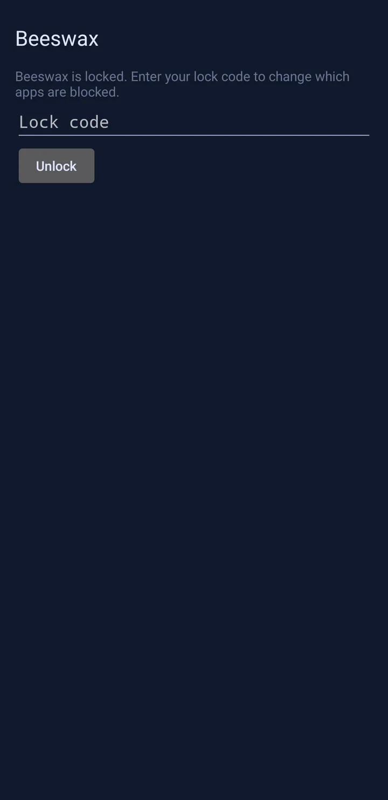
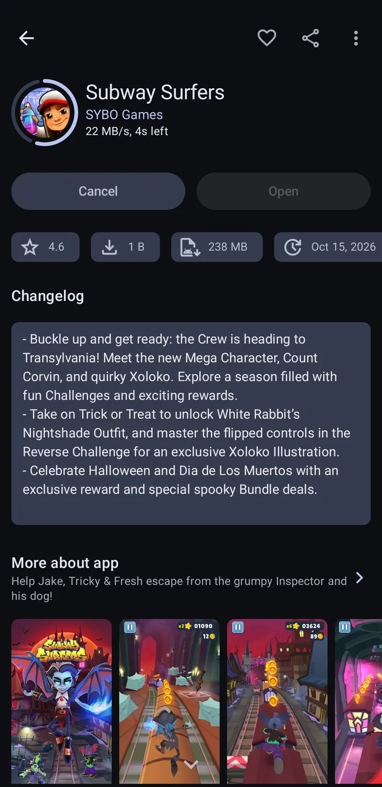
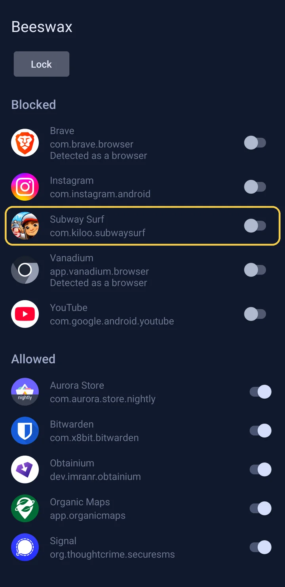

# Setup

## How it works

 
<b>Click here to see how it works</b>
  

-   **Beeswax restricts the phone you already use.** It's the device owner of the Owner profile, the standard way to manage a device on Android. You can't create other user profiles or private spaces.
-   **You pick what to block.** Before you lock, Beeswax lists your apps. Browsers start out blocked and every other app starts out allowed, and you can change any of them. Nothing is blocked until you tap Lock. Blocked apps disappear from the home screen and can't be opened.
-   **New apps are blocked.** When locked, every app installed afterward is blocked until you allow it in Beeswax with the lock code. Apps you've allowed keep updating as usual.
-   **The lock code is the only way back.** Lock creates a random 16 character lock code. Changing which apps are blocked, getting a new code, and deactivating Beeswax require the code. Beeswax stays locked until you deactivate it.
- **No bypasses.** Restarts, safe mode, private spaces, user profiles, and ADB cannot be used to bypass Beeswax.

## Before you start

-   You need an Android phone, a USB-C cable, and a computer with [ADB installed](https://developer.android.com/tools/adb). Beeswax is tested on GrapheneOS and stock Pixel OS. Other versions of Android haven't been tested yet.
-   **Back up all important data off your device.** You should do this even if you weren't using Beeswax, in case your phone gets lost or breaks. If you ever got locked out of Beeswax, you could still export all your data before factory resetting.
-   Android only allows a device owner on a phone with no accounts, no other users, and no Private Space. Remove every account, other user, and your Private Space. If you aren't able to get step 5 working, a factory reset will always work.
-   The lock code is what keeps Beeswax locked. Pick a way to keep it that you can't easily get to yourself. For example, have someone you trust keep it, or store it somewhere inconvenient. Whoever is holding the phone at the first Lock sees the code, so the person keeping it should do that step.
-   **If the lock code is lost, the only way back is a factory reset.** Not even ADB can remove Beeswax while it's locked.

## Instructions

1.  Install Beeswax.
2.  Enable Developer options: open Settings → About phone, tap Build number seven times, and enter your PIN or password.
3.  In Settings → System → Developer options, turn on USB debugging.
4.  Connect the phone to your computer. When the phone asks whether to allow USB debugging, tap Allow.
5.  On your computer, open a terminal (Command Prompt on Windows) and run the command Beeswax shows on its screen: `adb shell dpm set-device-owner org.getflourish.beeswax/.Receiver` Beeswax should now say "Pick the apps you want to block" and list your apps.
6.  Turn off Developer options in Settings → System → Developer options (this will also turn off USB debugging).
7.  Install the apps you want to keep. Then go through the list in Beeswax and switch off every app you want blocked, including any that let you browse the web (see [Usability limitations](#usability-limitations)). If you switch a browser on, you can still browse the web while Beeswax is locked. Rotating the phone or switching dark mode puts every switch back to how it started, so check the list again just before you lock.
8.  In Beeswax, tap Lock. Beeswax shows your new lock code.
9.  Save the lock code, tap "I've saved it", type the code back, and tap Lock. If the code doesn't match, Beeswax shows the same code again so you can check the copy you saved.
10. Check that Beeswax says "Beeswax is locked" and that the apps you switched off are gone from the home screen.

## Troubleshooting

-   **The `set-device-owner` command fails with an error about accounts or users.** An account, another user, or Private Space still exists. Remove it and run the command again. A reliable way to set up Beeswax is after a factory reset.
-   **ADB says no devices were found, or that the device is unauthorized.** Check that the cable is connected and USB debugging is on, then unplug and reconnect the phone and tap Allow when it asks.
-   **Beeswax says it can't be locked while another device admin app is on.** Android won't let Beeswax hide a device admin app. Turn it off in Settings → Security & privacy → More security & privacy → Device admin, then tap Lock again.
-   **Beeswax says it can't be locked while the phone has other users.** Each user and guests, have their own browser. Delete them in Settings → System → Users, then tap Lock again.

## Changing which apps are blocked

1.  Open Beeswax, enter the lock code, and tap Unlock. Beeswax shows your apps under Blocked and Allowed.
2.  Switch an app on to allow it, or off to block it. Each change happens right away.
3.  Tap Lock at the top, or leave Beeswax, to close the list. Beeswax itself stays locked.

To get a new lock code, tap New code in the list. Your current code keeps working until you've typed the new one back and tapped Save.

New users stay blocked, and so does debugging on release builds, until you deactivate Beeswax.

## Adding apps

While Beeswax is locked, every app you install is blocked right away and listed under Blocked in Beeswax. To allow one:

1.  Install the app as usual.
2.  Open Beeswax, enter the lock code, and tap Unlock.
3.  Switch the app on.

If Beeswax says an app is "Detected as a browser," think twice before allowing it. You can block an allowed app again by switching it off. If you uninstall an allowed app and install it again, it has to be allowed again.

Updates to an allowed app go through without the code, so an app you've allowed could add a way to browse the web in a later update. If one does, block it.

## To undo it

1.  Open Beeswax, enter the lock code, and tap Unlock. Deactivate shows in the list, and before the first Lock.
2.  Tap Deactivate and confirm. This unblocks every app and removes Beeswax's restrictions.
3.  You can now uninstall Beeswax.

To set up Beeswax again, you'll need the ADB command, and the phone must again have no accounts, no other users, and no Private Space.

## Usability limitations

-   Links that would normally open in a browser won't open while Beeswax is locked, unless you've allowed a browser.
-   WebView:
    -   **Vanadium System WebView and Vanadium Config aren't hidden**, so apps that need WebView keep working. But any app with a built-in browser may still let you browse the web, for example through a help link or an in-app browser. Choose the apps you allow with that in mind. You may need to block or uninstall an app if it's letting you bypass the restrictions. If an app lets you browse sites beyond the ones it needs, consider asking its developer to follow [Android security best practices](https://developer.android.com/privacy-and-security/security-best-practices#webview).
    -   **Wi-Fi sign-in pages still open.** Android's sign-in screen for networks like hotel or café Wi-Fi shows web pages too, and Beeswax doesn't hide it.
-   Beeswax finds browsers by asking Android which apps open web links. A few browsers don't declare that (for example Surf and Lite++), so Beeswax can't tell they're browsers. One installed before you lock is listed under Allowed without "Detected as a browser," so switch it off yourself. One installed after is blocked like any new app, but without the note.
-   Beeswax, the keyboards you've turned on, Settings, and the built-in phone, messaging and home screen apps you use are never listed or blocked. That way you can always type the lock code, make calls, send texts and reach factory reset. If you use an app you installed as your phone, messaging or home screen app, it's listed like any other app.
-   Other built-in apps with a home screen icon, like YouTube or Gmail on a Pixel, are listed and start out allowed. Blocking one also stops other apps from using it, for example to take a photo or pick a file. Blocking an app store stops it from updating your apps.
-   New users can't be added while Beeswax is locked, and Private Space is unavailable while Beeswax is the device owner.

## Screenshots

These are from Beeswax's test build.

<table>
  <tr>
    <td></td>
    <td></td>
  </tr>
  <tr>
    <td align="center">1. Pick what to block</td>
    <td align="center">2. Save your lock code</td>
  </tr>
  <tr>
    <td></td>
    <td></td>
  </tr>
  <tr>
    <td align="center">3. Lock it</td>
    <td align="center">4. Later, you install a game</td>
  </tr>
  <tr>
    <td></td>
  </tr>
  <tr>
    <td align="center">5. It's blocked until you enter your code</td>
  </tr>
</table>

